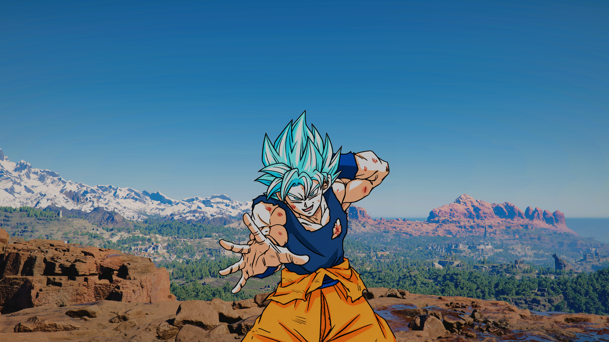

# Hi 👋, I'm Minh Nguyen

### A passionate developer from around the world

  

  

### 👨‍💻 About Me
- 🔭 I'm currently a **Software Engineering Student x IUH**

<h3 align="left">Connect with me:</h3>

  
  

<h3 align="left">Languages and Tools:</h3>

  

<h3 align="left">GitHub Stats:</h3>

  
    
  

